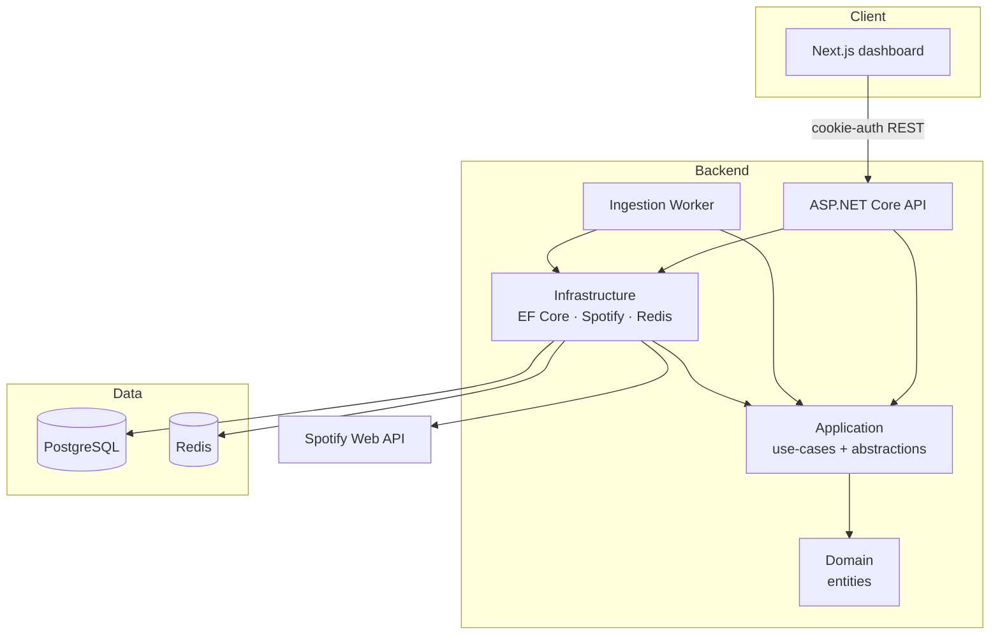
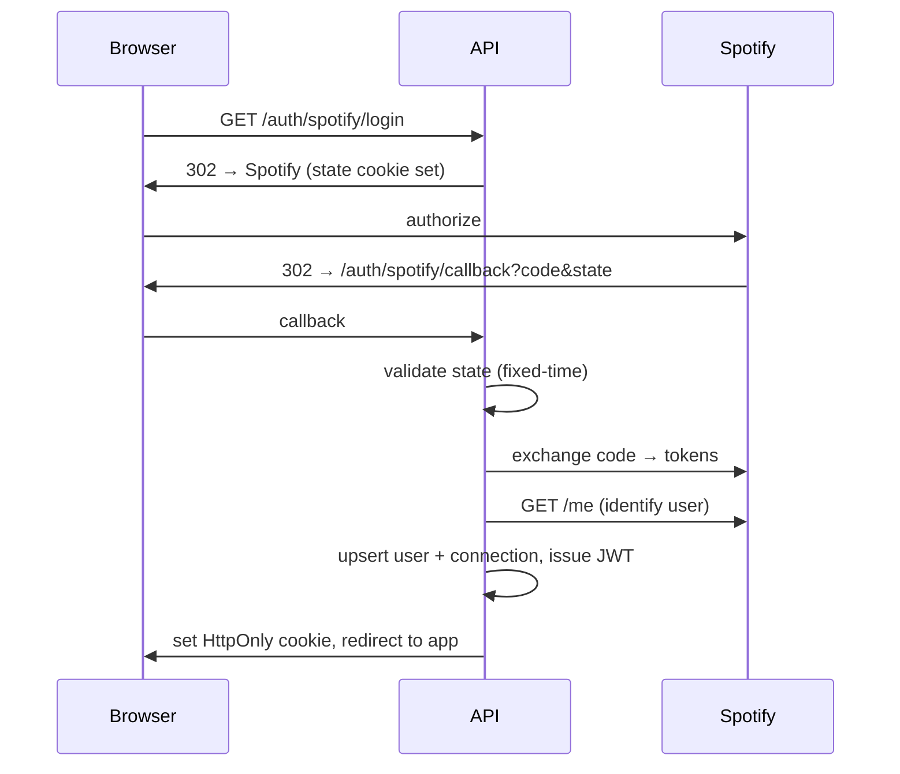

# VibeStream

A personal Spotify listening-intelligence platform: it ingests your play history, groups it into
sessions, computes analytics, and derives a deterministic "vibe" for every session — all served through
a versioned REST API and a dark, music-oriented Next.js dashboard.

## What is VibeStream?

VibeStream connects to your Spotify account, continuously imports your recently-played tracks in the
background, and turns that raw history into something you can actually read: how much you listened
today, your top artists and tracks, the rhythm of your listening across the week, the distinct
"sessions" you fall into, and the mood — the *vibe* — of each one.

The mood is computed by a **deterministic rules engine**, not an external AI service. That is a
deliberate design choice (see [Trade-offs](#trade-offs)).

## Features

- **Spotify OAuth** with server-side token storage — tokens never reach the browser.
- **Background ingestion** of recently-played history, idempotent and resilient to duplicates.
- **Session detection** — consecutive plays grouped by a 15-minute-gap rule.
- **Analytics** — today's summary, a 7-day chart, top artists/tracks, and peak listening hour.
- **Vibe engine** — a deterministic energy/mood classifier that labels each session and powers a
  "Listening DNA" breakdown.
- **Redis caching** for analytics with versioned-key invalidation.
- **Dashboard** — dark, responsive Next.js UI with loading, empty, and error states throughout.

## Architecture

A **modular monolith** with a strict dependency direction. Domain has zero infrastructure dependencies;
everything points inward.



- **Domain** — pure entities, no EF/ASP.NET/Redis.
- **Application** — use-case services and the interfaces Infrastructure implements (`ISpotifyClient`,
  `IVibeClassifier`, `ICacheService`, …). Pure logic like the session detector and vibe engine lives here.
- **Infrastructure** — EF Core (PostgreSQL), the Spotify HTTP clients, Redis, and the service
  implementations.
- **Api** — HTTP surface (controllers, auth, error handling). **Worker** — the background ingestion loop.
  Both are thin composition roots over `AddInfrastructure`.

## System Design

- **Ingestion is a background job, never a user request.** The worker polls per connected user, so the
  API stays fast and the import is decoupled from anyone being online.
- **PostgreSQL is the single source of truth.** Redis is a pure cache; it can be wiped or unavailable
  without affecting correctness.
- **Sessions and analytics are derived data**, rebuilt from events — the events table is append-only
  and authoritative.
- **Time is injected** (`TimeProvider`) so token expiry, session gaps, and "today" are testable.

## Tech Stack

| Layer | Choice |
| --- | --- |
| Language / runtime | C# / .NET 10 |
| API | ASP.NET Core, OpenAPI + Scalar |
| Data | PostgreSQL (Npgsql, EF Core 10, snake_case) |
| Cache | Redis (StackExchange.Redis) |
| Auth | Spotify OAuth 2.0 + JWT in an HttpOnly cookie |
| Background work | .NET Worker (`BackgroundService`) |
| Frontend | Next.js 15 (App Router), TypeScript, Tailwind CSS v4 |
| Tests | xUnit |
| Local infra | Docker Compose |

## Project Structure

```
src/
  VibeStream.Domain/          entities (User, Track, ListeningEvent, sessions, stats, vibe)
  VibeStream.Application/     use-cases + abstractions (Spotify, Ingestion, Sessions, Analytics, Vibes, Caching)
  VibeStream.Infrastructure/  EF Core, Spotify clients, Redis, service implementations, migrations
  VibeStream.Api/             controllers, JWT cookie auth, error handling, health checks
  VibeStream.Worker/          the ingestion BackgroundService
tests/
  VibeStream.UnitTests/       session detector + vibe engine (pure logic)
  VibeStream.IntegrationTests/
web/                          Next.js dashboard
```

## Data Model

- **User** ← **SpotifyConnection** (1:1, tokens, cascade delete)
- **Artist** ← **Track** (many tracks per artist)
- **ListeningEvent** — one play; unique on `(UserId, TrackId, PlayedAt)` for idempotency
- **ListeningSession** ← **SessionTrack** (ordered, composite key `(SessionId, Position)`)
- **DailyStatistic** — per-day rollup, unique on `(UserId, Date)`
- **VibeSnapshot** — a session's computed vibe (optional link back to the session)

Delete behaviors are explicit: **Cascade** for owned children, **Restrict** for referenced data
(you can't delete a Track that has plays), **SetNull** for a vibe whose session is rebuilt.

## Spotify OAuth Flow



Spotify tokens are stored server-side only. The browser holds a JWT (with no Spotify token in it) in an
HttpOnly cookie, so it's safe from XSS token theft. OAuth `state` is validated in constant time.

## Ingestion Pipeline

Each worker cycle, per connected user: get a valid access token (refreshing if near expiry) → fetch
recently-played → upsert artists/tracks → idempotently insert events → rebuild the affected session →
vibe it → refresh daily stats → invalidate the analytics cache. One user's failure never stops the others.

## Idempotency

Spotify's recently-played overlaps between polls. Two layers prevent duplicates: an in-memory filter
over already-stored keys, and — the real guarantee — a **unique index on `(UserId, TrackId, PlayedAt)`**.
A unique-violation is caught and treated as "already have it," so re-runs are safe.

## Caching

Analytics reads use **cache-aside** (5-minute TTL) behind a fail-open cache — if Redis is down, reads
fall through to Postgres and never error. Invalidation uses **versioned keys**: a single per-user counter
is incremented after ingestion, which orphans every cached entry for that user at once (they then expire),
avoiding any `SCAN`/`KEYS` sweep.

## Failure Handling

- **Spotify data calls** retry on `429` (honouring `Retry-After`), `5xx`, and network errors with bounded
  exponential backoff and a hard attempt cap.
- **Token expiry** is handled proactively (refresh before use) and persisted.
- **Unhandled errors** return RFC 9457 ProblemDetails — logged in full server-side, never leaked to clients.
- **Health checks** split liveness (`/health/live`) from readiness (`/health/ready`, checks Postgres +
  Redis). Spotify availability is deliberately NOT a readiness requirement.

## Local Setup

Prerequisites: .NET 10 SDK, Node 20+, Docker.

```bash
# 1. Start dependencies (Postgres + Redis)
docker compose up -d

# 2. Configure secrets (dev) via user-secrets
dotnet user-secrets set "Spotify:ClientId"     "<id>"     --project src/VibeStream.Api
dotnet user-secrets set "Spotify:ClientSecret" "<secret>" --project src/VibeStream.Api
dotnet user-secrets set "Jwt:SigningKey"       "<32+ random chars>" --project src/VibeStream.Api
# the Worker needs the Spotify creds too:
dotnet user-secrets set "Spotify:ClientId"     "<id>"     --project src/VibeStream.Worker
dotnet user-secrets set "Spotify:ClientSecret" "<secret>" --project src/VibeStream.Worker

# 3. Apply migrations
dotnet ef database update --project src/VibeStream.Infrastructure --startup-project src/VibeStream.Api

# 4. Run
dotnet run --project src/VibeStream.Api      # http://127.0.0.1:5062
dotnet run --project src/VibeStream.Worker
cd web && npm install && npm run dev          # http://127.0.0.1:3000
```

Register `http://127.0.0.1:5062/api/v1/auth/spotify/callback` as a redirect URI on your Spotify app
(Spotify requires `127.0.0.1`, not `localhost`, for loopback).

## Environment Variables

Used by the containerized stack (`docker-compose.app.yml`); see `.env.example`.

| Variable | Purpose |
| --- | --- |
| `SPOTIFY_CLIENT_ID` / `SPOTIFY_CLIENT_SECRET` | Spotify app credentials |
| `SPOTIFY_REDIRECT_URI` | Must match the Spotify dashboard exactly |
| `JWT_SIGNING_KEY` | ≥32 chars (HMAC-SHA256) |
| `FRONTEND_BASE_URL` / `PUBLIC_API_BASE_URL` | SPA and API origins |

Local dev keeps secrets in .NET user-secrets (outside the repo). In config they map with `__`, e.g.
`ConnectionStrings__Postgres`.

## Running the Project (all in Docker)

```bash
cp .env.example .env    # fill in the values
docker compose -f docker-compose.app.yml up --build -d
dotnet ef database update --project src/VibeStream.Infrastructure --startup-project src/VibeStream.Api
# open http://127.0.0.1:3000
```

## Testing

```bash
dotnet test
```

The pure logic — session detection and the vibe engine — has focused unit tests (empty history, the
exact 15-minute boundary, every vibe quadrant, scoring properties), because deterministic code is
exactly what's cheap and valuable to test.

## API Endpoints

```
GET  /api/v1/auth/spotify/login          POST /api/v1/auth/logout
GET  /api/v1/auth/spotify/callback
GET  /api/v1/me                          GET  /api/v1/me/now-playing
GET  /api/v1/listening/recent
GET  /api/v1/sessions                    GET  /api/v1/sessions/{id}
GET  /api/v1/analytics/today             GET  /api/v1/analytics/weekly
GET  /api/v1/analytics/top-artists       GET  /api/v1/analytics/top-tracks
GET  /api/v1/vibes/current               GET  /api/v1/vibes/history
GET  /api/v1/vibes/dna
GET  /health   /health/live   /health/ready
```

Interactive docs (Development): `http://127.0.0.1:5062/scalar/v1`.

## Trade-offs

- **Modular monolith over microservices.** One deployable, one database, clear internal boundaries. The
  seams (Application interfaces) are where services *could* be split later — but at this scale, network
  hops and distributed transactions would be pure cost.
- **PostgreSQL for everything, Redis only as a cache.** One source of truth avoids dual-write consistency
  problems. Redis accelerates repeated analytics reads and is treated as disposable.
- **Background worker instead of synchronous ingestion.** Importing on a user request would make it slow
  and couple freshness to traffic. The worker decouples the two and enables idempotent retries.
- **Deterministic vibe classification instead of an AI dependency.** Spotify's `audio-features` endpoint
  is deprecated for new apps, and a per-track LLM call would be slow, costly, and non-reproducible. The
  engine derives energy/valence/danceability from *available* metadata (popularity, release year, track
  length, time of day) with transparent, testable rules — the same input always yields the same vibe.
- **In-memory aggregation for analytics.** At personal scale a windowed projection aggregated in the app
  is simpler and provider-agnostic; the daily-rollup table exists for the parts that benefit from
  precomputation.

## Scaling Strategy

Events and sessions partition cleanly by user, so the worker could shard users across instances. Analytics
already sit behind a cache and precomputed rollups. If a dimension outgrew the monolith, its Application
interface is the extraction seam. Postgres read replicas would absorb read-heavy analytics before any
rearchitecture.

## Screenshots

_Add dashboard / analytics / sessions screenshots here._

## Future Improvements

- Live now-playing progress and richer vibe inputs (genres via the artists endpoint).
- Natural-language search over history.
- Prometheus metrics (`ingestion_events_processed`, `analytics_cache_hits`, …).
- Per-user time zones for day bucketing.
